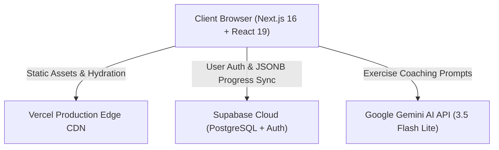

# 🎓 Product Discovery School

> **Master continuous product discovery habits through hands-on exercises, real-time Gemini AI coaching, and interactive frameworks.**

[](https://product-discovery-school-tan.vercel.app)
[](https://github.com/prathmeshmdeshmane001/product-discovery-school)
[](https://nextjs.org)
[](https://react.dev)
[](https://tailwindcss.com)
[](https://supabase.com)
[](https://aistudio.google.com)

---

## 📖 Executive Summary

Most product managers, founders, and designers learn product discovery through passive slide decks, book summaries, or theoretical lectures. **Product Discovery School** changes that paradigm by offering an active, interactive sandbox where learners actually perform discovery work.

Built around industry-standard methodologies popularized by Teresa Torres (*Continuous Discovery Habits*), Clayton Christensen (*Jobs-to-be-Done*), and Eric Ries (*The Lean Startup*), the platform combines structured curriculum modules with personalized, real-time AI feedback and visual mapping tools.

---

## 🌟 Key Features

### 1. 📚 10 Interactive Curriculum Modules
Structured step-by-step learning spanning four core disciplines: **Strategy**, **Research**, **Testing**, and **Analytics**.

Each module consists of a 3-step mastery loop:
1. **Concept & Real-World Example:** High-impact breakdown of modern discovery theory with concrete case studies (e.g., Slack, Spotify, Zoom, Zappos, Airbnb).
2. **Applied Exercise:** Hands-on drafting prompt where the learner writes realistic discovery artifacts (opportunity statements, interview questions, assumption tests, RICE calculations).
3. **Knowledge Check Quiz:** Gamified multi-choice question with instant feedback, explanations, and animation effects (shake on wrong answers, confetti bounce on correct answers).

| # | Module Title | Category | Core Objective |
| :---: | :--- | :---: | :--- |
| **1** | **Define the Problem** | Strategy | Separate the problem space from the solution space to avoid premature feature lock-in. |
| **2** | **Know Your Users** | Research | Master continuous weekly interviewing techniques and avoid leading hypothetical questions. |
| **3** | **Map Your Assumptions** | Strategy | Deconstruct solutions into desirability, viability, feasibility, usability, and ethical hypotheses. |
| **4** | **Run Experiments** | Testing | Design low-cost validation experiments (Smoke tests, Concierge, Wizard of Oz) before coding. |
| **5** | **Opportunity Mapping** | Strategy | Connect target business outcomes to user opportunities and candidate solutions via OST. |
| **6** | **Prioritisation Frameworks** | Strategy | Quantify decision-making using RICE scores `(Reach * Impact * Confidence) / Effort`. |
| **7** | **Success Metrics** | Analytics | Establish your North Star Metric and connect actionable leading input metrics to lagging outcomes. |
| **8** | **Jobs to Be Done (JTBD)** | Research | Uncover the underlying context and struggle for which users "hire" a product. |
| **9** | **How Might We (HMW)** | Strategy | Reframe verified user frictions into constructive brainstorming prompts. |
| **10** | **Discovery Canvas (Capstone)** | Strategy | Synthesize all 9 modules into a complete, exportable Product Discovery Canvas. |

---

### 2. 🤖 Real-Time Gemini AI Coaching
- Integrated with Google's **Gemini 3.5 Flash Lite** model (`gemini-3.5-flash-lite`).
- Evaluates the user's freeform exercise answers in real time.
- Operates under a specialized system prompt: acts as a senior product discovery coach, highlighting **1 specific strength** and **1 concrete actionable improvement** in 2–3 sentences without filler preambles.
- Triggers celebratory confetti upon receiving coaching feedback.

---

### 3. 🗺️ Dynamic Opportunity-Solution Tree (OST) Builder
- An interactive visual tree builder inspired by Teresa Torres' framework.
- Allows product teams to define:
  - **Business Outcome** (e.g., *"Increase 30-day user retention by 20%"*).
  - **Customer Opportunities** (pain points, unmet needs, or user struggles).
  - **Candidate Solutions** linked directly under each parent opportunity.
- Supports node editing, custom branches, and persistence straight to Supabase or local storage.

---

### 4. 🔄 Dual-Mode Persistence & Seamless Migration
- **Guest Mode:** First-time visitors can dive right into learning without creating an account. Progress, exercises, and OST maps are saved locally in `localStorage` and `sessionStorage`.
- **Authenticated Mode (Supabase):** Learners can create an account (or log in) with email and password at any point. 
- **Auto-Migration:** Any existing guest progress in the browser is automatically merged and migrated to the cloud upon registration or sign-in without losing data.

---

### 5. 🎯 Gamification & Capstone Canvas
- **Progress Speedometer:** An SVG gauge displaying course completion percentage with dynamic status zones (Getting Started -> Building Momentum -> Almost There -> Discovery Master).
- **Milestone Badges:** Live trackers for completed modules, XP point pop-ups, streak indicators, and trophy unlocks.
- **Capstone Discovery Canvas:** Finishing all modules unlocks a formatted Discovery Canvas summarizing the student's problem statement, user research, assumption tests, and validation experiments, ready to copy or share with stakeholders.

---

### 6. 📚 Discovery Resources & Community Board
- **Research Library:** Curated collection of seminal books, articles, and video workshops (Teresa Torres, Clayton Christensen, Eric Ries, IDEO).
- **Community Board:** Interactive forum to share completed capstone canvases, ask prioritization questions, upvote peer contributions, and discuss discovery methodologies.

---

## 🏗️ Architecture & Tech Stack



| Layer | Technology | Details |
| :--- | :--- | :--- |
| **Frontend Framework** | [Next.js 16.2.9](https://nextjs.org/) | App Router, React 19 Server/Client Components, Turbopack |
| **Language** | [TypeScript 5](https://www.typescriptlang.org/) | Full type safety across modules, progress state, and OST nodes |
| **Styling** | [Tailwind CSS v4](https://tailwindcss.com/) | Theme tokens via `@theme inline`, light/dark mode support |
| **Typography** | [Google Fonts](https://fonts.google.com/) | `Plus Jakarta Sans` for body/headings and `Geist Mono` |
| **Database & Auth** | [Supabase](https://supabase.com/) | Managed PostgreSQL, Row-Level Security (RLS), Supabase Auth |
| **AI Integration** | [Google Gemini API](https://aistudio.google.com/) | Real-time coaching via RESTful `generateContent` endpoint |
| **Deployment** | [Vercel](https://vercel.com/) | Production CI/CD linked to GitHub `main` branch |

---

## 🗄️ Database Schema (Supabase)

The cloud backend is managed by Supabase using a clean, normalized relational table with JSONB document storage for module progress:

```sql
-- Create user_progress table
CREATE TABLE IF NOT EXISTS public.user_progress (
    user_id UUID PRIMARY KEY REFERENCES auth.users(id) ON DELETE CASCADE,
    progress JSONB NOT NULL DEFAULT '[]'::jsonb,
    updated_at TIMESTAMP WITH TIME ZONE DEFAULT timezone('utc'::text, now()) NOT NULL
);

-- Enable Row Level Security (RLS)
ALTER TABLE public.user_progress ENABLE ROW LEVEL SECURITY;

-- Allow authenticated users to view only their own progress
CREATE POLICY "Users can view their own progress"
    ON public.user_progress FOR SELECT TO authenticated
    USING (auth.uid() = user_id);

-- Allow authenticated users to insert their own progress
CREATE POLICY "Users can insert their own progress"
    ON public.user_progress FOR INSERT TO authenticated
    WITH CHECK (auth.uid() = user_id);

-- Allow authenticated users to update their own progress
CREATE POLICY "Users can update their own progress"
    ON public.user_progress FOR UPDATE TO authenticated
    USING (auth.uid() = user_id) WITH CHECK (auth.uid() = user_id);

-- Allow authenticated users to delete their own progress
CREATE POLICY "Users can delete their own progress"
    ON public.user_progress FOR DELETE TO authenticated
    USING (auth.uid() = user_id);
```

---

## ⚙️ Environment Variables

Create a `.env.local` file in the root directory (modeled after `.env.example`):

```bash
# Supabase Configuration
NEXT_PUBLIC_SUPABASE_URL=https://your-project-id.supabase.co
NEXT_PUBLIC_SUPABASE_ANON_KEY=your-supabase-anon-key

# Gemini AI Coaching API Configuration
NEXT_PUBLIC_GEMINI_API_KEY=your-gemini-api-key
```

### Where to Obtain Credentials
1. **`NEXT_PUBLIC_SUPABASE_URL` & `NEXT_PUBLIC_SUPABASE_ANON_KEY`**: 
   - Sign up at [Supabase](https://supabase.com).
   - Create a project -> Navigate to **Project Settings** -> **API** -> Copy the **Project URL** and `anon` / `public` API key.
2. **`NEXT_PUBLIC_GEMINI_API_KEY`**:
   - Visit [Google AI Studio](https://aistudio.google.com/app/apikey).
   - Click **Create API Key**.

---

## 🚀 Local Development Setup

### Prerequisites
- Node.js `v20+` or `v24+`
- npm `v10+`

### 1. Clone the Repository
```bash
git clone https://github.com/prathmeshmdeshmane001/product-discovery-school.git
cd product-discovery-school
```

### 2. Install Dependencies
```bash
npm install
```

### 3. Setup Environment Variables
```bash
cp .env.example .env.local
# Open .env.local and add your Supabase and Gemini credentials
```

### 4. Run Development Server
```bash
npm run dev
```

### 5. Build & Lint
```bash
# Validate TypeScript compilation & generate static production build
npm run build

# Run code style & lint check
npm run lint
```

---

## 🚢 Deployment (Vercel)

The project is preconfigured with [`vercel.json`](file:///Users/prathameshdeshmane/product%20discovery%20school/vercel.json) for instantaneous deployment to Vercel:

1. **Push to GitHub**:
   ```bash
   git push origin main
   ```
2. **Connect Project on Vercel**:
   - Import the repository `prathmeshmdeshmane001/product-discovery-school`.
   - Under **Project Settings -> Environment Variables**, add:
     - `NEXT_PUBLIC_SUPABASE_URL`
     - `NEXT_PUBLIC_SUPABASE_ANON_KEY`
     - `NEXT_PUBLIC_GEMINI_API_KEY`
3. Every commit pushed to `main` automatically triggers an optimized Turbopack build and deploys to production.

---

## 👨‍💻 Author & Acknowledgments

- **Project Owner:** Prathamesh Deshmane
- **Methodological Inspiration:**
  - Teresa Torres (*Continuous Discovery Habits*)
  - Clayton Christensen (*Competing Against Luck / Jobs-to-be-Done*)
  - Eric Ries (*The Lean Startup*)
- **License:** MIT License
